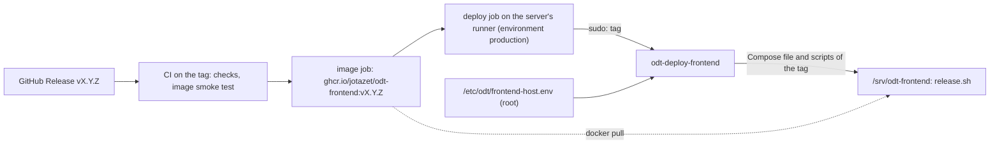

# Production deployment (Docker Compose)

The frontend runs with a single Docker Compose command. Configuration (API URL, site URL, port) lives in `.env`. Production is updated by release tags `vX.Y.Z`, which run the image CI built ([section 6](#6-releases-automatic-deployment-from-github)); sections 1–5 describe the setup underneath and a deployment by hand.

> **Note:** Next.js inlines `NEXT_PUBLIC_*` variables into the bundle at **build** time, not when the container starts. That is why they are passed as build args, and every change to them needs a **rebuild** (`--build`, or on production a new release), not just a restart.

## 1. Configuration

```bash
cp .env.example .env
```

Fill in `.env`:

- `NEXT_PUBLIC_API_BASE_URL` – public API URL, e.g. `https://v2.api.odt.org.pl`
- `NEXT_PUBLIC_SITE_URL` – public site URL, e.g. `https://v2.odt.org.pl`
- `FRONTEND_PORT` – host port (default `3000`)
- `FRONTEND_BIND` – host address of the port (default `127.0.0.1`, for a reverse proxy on the same host). The container trusts `X-Forwarded-For`, so use `0.0.0.0` only for testing from the LAN.
- `API_HOSTNAME` – the host of `NEXT_PUBLIC_API_BASE_URL`, e.g. `api.odt.org.pl`, when the API's reverse proxy runs on this machine: server-side rendering then reaches it directly, not through the CDN (see [section 4](#4-reverse-proxy--tls)). Leave unset otherwise.

## 2. Build and start

```bash
docker compose up -d --build
```

The image (`Dockerfile`, Node 24 LTS pinned by digest) holds only Next.js's standalone server (`output: "standalone"`), its static files and `public/`, and runs `node server.js` as the user `node`. Compose runs it with a read-only file system (the server writes only its cache, a `tmpfs`), no capabilities, `no-new-privileges`, a memory limit (`FRONTEND_MEM_LIMIT`, default `768m`), a process limit and rotated logs.

## 3. Verification

On production run these as `odt` in `/srv/odt-frontend` (`sudo -u odt sh`), and take the API host from the repository variable `NEXT_PUBLIC_API_BASE_URL`: the server's `.env` does not hold it.

```bash
# the API host from .env must be in the built bundle (it is absent when the build did not get it):
API_HOST=$(grep '^NEXT_PUBLIC_API_BASE_URL=' .env | cut -d= -f2- | sed 's#^https\?://##')
docker exec odt-frontend sh -c "grep -rlo '$API_HOST' .next/ | wc -l"   # more than 0
# the landing page returns 200 (use your FRONTEND_PORT):
curl -i http://localhost:3000/pl
# with API_HOSTNAME: the API host resolves to this machine and answers (prints its address, then OK):
API_HOSTNAME=$(grep '^API_HOSTNAME=' .env | cut -d= -f2-)
docker exec odt-frontend sh -c "grep ' $API_HOSTNAME\$' /etc/hosts; wget -q -O /dev/null 'https://$API_HOSTNAME/api/blog/posts/?page_size=1' && echo OK"
```

Don't check for the absence of `http://localhost:8000`: it is always in the bundle as the fallback after `||` in `lib/config.ts` and `next.config.ts`, even when the API URL was inlined correctly.

## 4. Reverse proxy + TLS

Put a reverse proxy (nginx/Caddy) in front of the container that routes the site's domain to `127.0.0.1:${FRONTEND_PORT}` and forwards the `X-Forwarded-Proto: https` header and the visitor's IP in `X-Forwarded-For` (the rightmost entry is used). With Caddy:

```caddy
example.org {
    reverse_proxy 127.0.0.1:3000 {
        header_up X-Forwarded-For {client_ip}
    }
}
```

Server-side rendering forwards that IP to the API, so the backend rate-limits each visitor separately. With `API_HOSTNAME` these calls reach the API's reverse proxy on this machine instead of the CDN, which would replace the IP; that proxy must accept `X-Forwarded-For` from the Docker networks. Its configuration and the deployment order are in [section 13 of the backend's `docs/deployment.md`](https://github.com/jotazet/OtwarteDaneTransportowe-backend/blob/main/docs/deployment.md#client-ip-cdn-and-the-frontend); background in [ADR 0011](https://github.com/jotazet/OtwarteDaneTransportowe-backend/blob/main/docs/architecture/decisions/0011-client-ip-behind-cloudflare-and-ssr.md).

The application sets its own security headers on every response (`securityHeaders` in `next.config.ts`), including `Strict-Transport-Security` for two years without `includeSubDomains`: serve the site's domain over HTTPS only. The reverse proxy does not need to add them.

Pages also get an enforced `Content-Security-Policy` header with a per-request nonce, set in `proxy.ts` ([ADR 0008](architecture/decisions/0008-content-security-policy-with-nonce.md)). Its `connect-src` and `img-src` allow the origin of `NEXT_PUBLIC_API_BASE_URL`, which is read at build time. Do not let the reverse proxy or CDN inject scripts into the HTML (e.g. Cloudflare Web Analytics, Email Address Obfuscation, Rocket Loader): the browser blocks them, and a feature that depends on them breaks. In Cloudflare these stay off for the site's domain. If the policy breaks a page in production, send it as `Content-Security-Policy-Report-Only` again (the two header names in `proxy.ts`) and redeploy.

## 5. Updates by hand

```bash
git pull
docker compose up -d --build
```

On production use a release (section 6): it has no checkout, its `.env` is generated from the host file, and a hand edit is overwritten by the next release.

## 6. Releases: automatic deployment from GitHub

A release tag `vX.Y.Z` on `main` deploys itself, the same way as the backend ([backend ADR 0013](https://github.com/jotazet/OtwarteDaneTransportowe-backend/blob/main/docs/architecture/decisions/0013-release-tags-deploy-from-a-server-runner.md) and [ADR 0016](https://github.com/jotazet/OtwarteDaneTransportowe-backend/blob/main/docs/architecture/decisions/0016-release-images-from-ghcr-without-a-server-checkout.md), [backend `docs/deployment.md`, section 20](https://github.com/jotazet/OtwarteDaneTransportowe-backend/blob/main/docs/deployment.md#20-releases-automatic-deployment-from-github)). A change that also needs the backend is released there first.



1. **CI** (`.github/workflows/ci.yml`) runs every check on the tag on GitHub's runners, including a build of the image that must start as in production and turn healthy. Then the `image` job builds the production image with the `NEXT_PUBLIC_*` repository variables and pushes it to GitHub's registry as `ghcr.io/jotazet/odt-frontend:vX.Y.Z` and `:sha-<commit>` (every push to `main` gets `:main`). The `deploy` job runs only when all of them pass, on the self-hosted runner on the server registered to this repository (label `odt-production`, user `odt-runner`).
2. It runs `/usr/local/sbin/odt-deploy-frontend` through sudo as `odt`, the owner of the deployment directory `/srv/odt-frontend`; for this repository it is the only command `odt-runner` may run that way. The tag is its only input. It refuses a tag that is not `vX.Y.Z`, asks GitHub's API for the tag's commit and refuses it unless it is on `main`, downloads that commit's `docker-compose.yml` and `scripts/deploy/` into the deployment directory and runs its `release.sh`. There is no Git checkout on the server.
3. **`release.sh`** builds `.env` from the [host file](#the-host-file) and adds `ODT_VERSION=vX.Y.Z`, pulls that image (nothing running changes yet), installs the `.env`, recreates the container with `docker compose -f docker-compose.yml up -d --no-build --wait` and waits up to 3 minutes for its healthcheck (`/pl`). Then the images of all but the newest 3 releases are removed from the host (the registry keeps every one). Any failure stops it and the job turns red; a failure before `up` changes nothing that runs.

Nothing is built on the server, so a release does not compete with OpenTripPlanner for memory and may run during a planner graph build. There is no database, so there is no backup step.

### Releasing

Merge to `main`, then on GitHub: _Releases → Draft a new release → Choose a tag →_ a new tag `vX.Y.Z` on `main` → _Generate release notes → Publish_. Or from a clean `main`:

```bash
git tag -a v1.0.0 -m "v1.0.0" && git push origin v1.0.0
```

[Semantic Versioning](https://semver.org/): MAJOR for a change that needs a coordinated backend release or breaks links, MINOR for features, PATCH for fixes. The job's log shows `odt-deploy-frontend: <old> -> <new>` and `release: vX.Y.Z is live`.

### GitHub settings

- **Repository variables** (_Settings → Secrets and variables → Actions → Variables → Repository variables_): `NEXT_PUBLIC_API_BASE_URL` and `NEXT_PUBLIC_SITE_URL`, the production URLs. The `image` job inlines them into the bundle and stops without them, because the build would otherwise fall back to `http://localhost:8000` and the site would still answer. They are in every page anyway, so they are not secrets; the image of `main` uses them too.
- **Environment `production`** (_Settings → Environments_): _Deployment branches and tags → Selected branches and tags_, the tag rule `v*`. It holds no variables or secrets: the deploy job sends the server only the tag.
- **The package** `odt-frontend` (_the owner's profile → Packages_) must be **public**, as the repository is: the server pulls without logging in, and the image holds only the public repository's code and the public URLs above. GitHub creates it private on the first push: _Package settings → Change visibility → Public_ once. Check from any machine: `docker pull ghcr.io/jotazet/odt-frontend:main`.
- Under _Settings → Actions → General → Fork pull request workflows from outside collaborators_, choose **Require approval for all outside collaborators**: a pull request can change `ci.yml` and send a job to the server's runner, so read a fork's workflow changes before approving its run.

The `image` job pushes with the workflow's own token (`packages: write` on that job only), so nothing is stored for it. Pull requests build the image but never push it.

### The host file

`/etc/odt/frontend-host.env`, written by root, holds every setting of the container on the host. `release.sh` accepts only these lines, each optional, with values of letters, digits and `. : / _ -` (no quotes, spaces, `$` or `#`), and for any other line refuses the release before it changes anything, Compose's own `COMPOSE_*` included:

- `FRONTEND_BIND`, `FRONTEND_PORT` (section 1; default `127.0.0.1:3000`),
- `API_HOSTNAME` (section 1),
- `FRONTEND_MEM_LIMIT`, the container's memory ceiling (default `768m`).

`odt-deploy-frontend` refuses to run unless the file and `/etc/odt` are owned by root and writable by nobody else. For example:

```dotenv
FRONTEND_BIND=127.0.0.1
FRONTEND_PORT=3000
API_HOSTNAME=api.example.org
```

The Compose project name is fixed in `docker-compose.yml` (`otwarte-dane-transportowe-frontend`), so the container and its network keep their names whatever the directory is called.

### One-time server setup

As the server's admin user. The user `odt`, the user `odt-runner`, `/etc/odt` and `/opt/actions-runner/` already exist from the backend ([its section 20](https://github.com/jotazet/OtwarteDaneTransportowe-backend/blob/main/docs/deployment.md#one-time-server-setup)); both projects deploy as `odt`. Read `odt-deploy-frontend` before installing it as root:

```bash
# The deployment directory, owned by the application's user.
sudo install -d -o odt -g odt -m 750 /srv/odt-frontend

# The host settings, written by root (see "The host file" above).
sudoedit /etc/odt/frontend-host.env
sudo chown root:root /etc/odt/frontend-host.env && sudo chmod 644 /etc/odt/frontend-host.env

# The deploy command from main, owned by root; reinstall it whenever it changes.
curl -fsSL -o /tmp/odt-deploy-frontend \
  https://raw.githubusercontent.com/jotazet/otwarte-dane-transportowe-frontend/main/scripts/deploy/odt-deploy-frontend
less /tmp/odt-deploy-frontend
sudo install -o root -g root -m 755 /tmp/odt-deploy-frontend /usr/local/sbin/odt-deploy-frontend && rm /tmp/odt-deploy-frontend

# odt-runner may also run this command as odt; a file of its own leaves the backend's untouched.
echo 'odt-runner ALL=(odt) NOPASSWD: /usr/local/sbin/odt-deploy-frontend' \
  | sudo tee /etc/sudoers.d/odt-runner-frontend > /dev/null
sudo chmod 440 /etc/sudoers.d/odt-runner-frontend && sudo visudo -cf /etc/sudoers.d/odt-runner-frontend
```

The runner (version, checksum and registration token from this repository's _Settings → Actions → Runners → New self-hosted runner_; the label is the same as the backend's, because a runner registered to one repository never takes another repository's jobs):

```bash
sudo install -d -o odt-runner -g odt-runner -m 750 /opt/actions-runner/odt-frontend
curl -fsSLO https://github.com/actions/runner/releases/download/v<version>/actions-runner-linux-x64-<version>.tar.gz
echo "<sha256>  actions-runner-linux-x64-<version>.tar.gz" | sha256sum -c
sudo -u odt-runner tar xzf actions-runner-linux-x64-<version>.tar.gz -C /opt/actions-runner/odt-frontend
cd /opt/actions-runner/odt-frontend
sudo -u odt-runner ./config.sh --unattended --url https://github.com/jotazet/otwarte-dane-transportowe-frontend \
  --token <registration token> --name odt-vps-frontend --labels odt-production --work _work
sudo ./svc.sh install odt-runner && sudo ./svc.sh start
```

Check the restriction without deploying:

```bash
sudo -u odt-runner sudo -n -u odt /usr/local/sbin/odt-deploy-frontend nope
# odt-deploy-frontend: expected a release tag vX.Y.Z, got 'nope'
```

Both repositories' runners run as `odt-runner` and both deploy as `odt`, so code that reaches one runner can deploy any `main` tag of either project. It cannot choose a frontend setting: the frontend's deploy takes only the tag (for the backend's, see its ADR 0013, _Consequences_).

### Moving from the checkout to the deployment directory (once)

Until the first release, production runs from a Git checkout in the admin user's home and builds there. The fixed project name lets the first release replace that container in place:

1. Check that the running container belongs to the project `otwarte-dane-transportowe-frontend`: `docker inspect odt-frontend --format '{{index .Config.Labels "com.docker.compose.project"}}'`. If it prints another name, the first release stops at `up` with a container name conflict; then run `docker rm -f odt-frontend` and re-run the deploy job (the site is down until it finishes).
2. Copy `NEXT_PUBLIC_API_BASE_URL` and `NEXT_PUBLIC_SITE_URL` from the checkout's `.env` into the repository variables, and `FRONTEND_BIND`, `FRONTEND_PORT` and `API_HOSTNAME` into the host file. Delete the variables of the environment `production`, if any (`gh variable list --env production`): nothing reads them.
3. Do the [one-time setup](#one-time-server-setup), merge to `main` (its `image` job must pass), make the package public and release.
4. Check the site ([section 3](#3-verification)), then remove the old checkout and its images (`docker image ls odt-frontend`).

### Changing a setting

- `NEXT_PUBLIC_*`: change the repository variable, then make a new release; the image of an existing tag keeps the values it was built with.
- Host settings: change `/etc/odt/frontend-host.env` as root, then deploy: a new release, or re-run the `deploy` job of the latest release's run.

### Rolling back

- Release a fix (`vX.Y.Z+1` with the revert), or re-run the `deploy` job of the previous release's run: it deploys that tag's Compose file and image.
- **Emergency:** run the image of an earlier release. The host keeps the images of the last 3 releases; the registry keeps every one:

  ```bash
  cd /srv/odt-frontend
  docker image ls ghcr.io/jotazet/odt-frontend    # vX.Y.Z of the last 3 releases
  sudo -u odt sed -i 's/^ODT_VERSION=.*/ODT_VERSION=<last good vX.Y.Z>/' .env
  sudo -u odt docker compose -f docker-compose.yml pull frontend
  sudo -u odt docker compose -f docker-compose.yml up -d --no-build --wait frontend
  ```

  The Compose file and scripts stay those of the new release until the next deployment.

## CORS (backend)

The site calls the API from the browser, so add the site's origin to `CORS_ALLOWED_ORIGINS` and `CSRF_TRUSTED_ORIGINS` in the backend configuration. Otherwise the browser blocks the requests even though the endpoint is correct. See the backend's `docs/deployment.md`.
